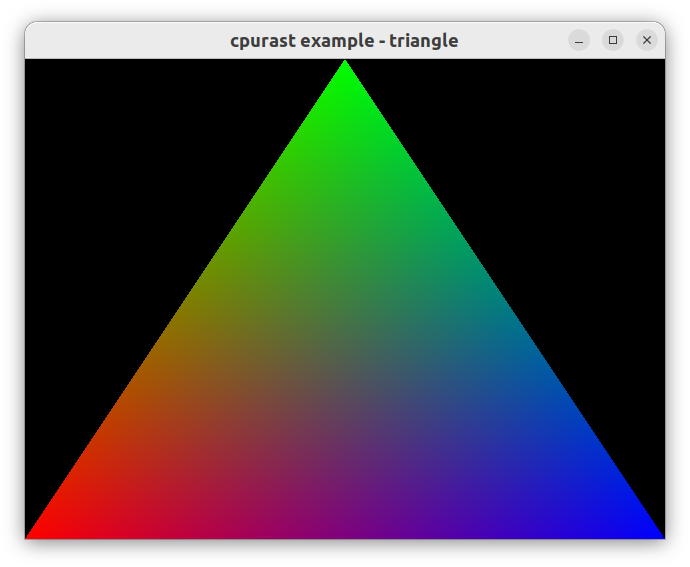

# CPU Rasterizer

<p align="center">
  
</p>

The cpurast is a software rasterizer written from scratch. Basically, it is a very simple and limited imitation of a graphics library (such as OpenGL), yet it performs all graphical computations on the processor. This approach is slower than utilizing a graphics processor but more flexible since it has no additional driver and hardware requirements. Furthermore, some concepts like packing and transferring data to the graphics processor are entirely omitted. Hence, the final use should be easier. Yet surprisingly, cpurast comes with some advanced [features](#features).

This project was created during my master's studies. I chose this assignment because I wanted to get an idea of what could be inside a real graphics processor so that it supports the functions of graphics libraries. When I started, I had just a little experience with computer graphics, so I had to study a lot. Feel free to take a look at the [used sources](#used-sources) from which I have gained my knowledge.

## Features

* Draws points, lines, and triangles
* Integer-based rasterization
* Interpolation of vertex attributes
* Programmable vertex and fragment shaders
* Early depth testing
* Viewport rendering
* Normalized coordinates and colors, both compatible with OpenGL
* Cross platform, minimal dependencies

## Repository Structure

* `cpurast` - this rasterization library
* `cpurast/sdl_canvas` - SDL canvas to draw on
* `examples` - example programs utilizing cpurast
* `examples/line` - dancing line with various angles and sizes
* `examples/triangle` - colored triangle with a resizable window
* `examples/square` - colored square utilizing squared viewport
* `examples/grid` - grid of randomly colored rectangles
* `shaders` - example cpurast shaders
* `shaders/lean_shader.hpp` - lean slope-moment vertex/fragment shaders
* `cpurast/normal_moments.hpp` - owning normal-moment mip texture

## Lean Slope-Moment Material

`cr::normal_moments` stores five raw moments of the slope pair
`p = nx/nz, q = ny/nz`: `E[p]`, `E[q]`, `E[p^2]`, `E[pq]`, `E[q^2]`.
The constructor copies the tightly packed `(nx, ny, nz)` array and keeps no
reference to it, so one texture may be shared by several shader objects.
Mip levels halve with rounding up; each cell averages its valid 2x2 sub-cells
weighted by the number of base texels they represent, so the 1x1 top level is
the full-image statistic. Sampling uses `u*w-0.5`, `v*h-0.5` repeat bilinear;
the two derivative columns are scaled by the original width/height and the
largest singular value `rho` selects a trilinear LOD of
`clamp(log2(max(1, rho)), 0, last)`. The five moments are blended first; the
mean and covariance are derived afterwards, never blended pre-reduced.

The shader pair `cr::lean_vertex_shader` / `cr::lean_fragment_shader` binds to
the existing `cr::context`. Input vertices are packed tightly (see
`shaders/lean_shader.hpp`): homogeneous clip position, view-space position,
normal, tangent, handedness (+1/-1), and UV. The vertex shader divides UV,
position, normal and tangent by `w` and appends `1/w`; the fragment shader
restores them with the analytic quotient rule. Geometry clipping is unchanged.

Enable the optional gradient callback on the production rasterizer to feed the
material:

```cpp
context.enable_fragment_gradients(); // implies attribute interpolation
context.bind_vertex_shader(std::make_shared<cr::lean_vertex_shader>());
context.bind_fragment_shader(std::make_shared<cr::lean_fragment_shader>(moments, material));
```

With gradients enabled, the fragment attributes and their `dx`/`dy` come from
one affine plane through the actually quantized integer canvas vertices, with
derivatives per canvas pixel. Points, lines, and disabled interpolation report
`has_2d_gradient == false` with zero derivatives and the provoking attributes;
old shaders keep the original `run(in)` path, coverage, depth competition, and
early depth order.

`examples/lean_cpu.cpp` renders a slanted crossed-slope material and writes a
P3 PPM:

```
c++ -std=c++17 -O2 -Icpurast -Ishaders examples/lean_cpu.cpp \
    cpurast/*.cpp shaders/*.cpp -o lean_cpu
./lean_cpu out.ppm
```

## How to Run Examples

Requirements to run examples:

* [SDL2 library](https://www.libsdl.org/)
* [CMake tools](https://cmake.org/)
* A C++ compiler

Building examples that use **cpurast**:

```
cd cpurast
mkdir build
cd build
cmake -DCMAKE_BUILD_TYPE="Release" ..
make -j
```

Running a **triangle** example after building:

```
./examples/triangle/triangle
```

## How to Use as a Library

Minimum requirements to use the library:

* A C++ compiler

What may be useful:

* Delivered CMake build system
* Delivered examples of use

> It is suggested to start with an existing example, copy it to a new example directory, and start customizing it. Later, after some experience with using and building cpurast, the created program may be used as the foundation of a new project.

### Using a Custom Canvas

This library comes with **SDL canvas** to draw on:

```cpp
#include "cpurast.hpp" // cpurast core
#include "cpurast_sdl.hpp" // cpurast SDL canvas

SDL_Surface* surface = /* pointer initialization */;
...
std::unique_ptr<cr::canvas> cr_canvas;
...
cr_canvas = std::make_unique<cr::sdl_canvas>(surface);
```

You may also create and use a **custom canvas**:

```cpp
#include "canvas.hpp" // cpurast canvas interface

class custom_canvas : public cr::canvas
{
...
}
```

```cpp
#include "cpurast.hpp" // cpurast core
#include "cpurast_custom.hpp" // cpurast custom canvas

std::unique_ptr<cr::canvas> cr_canvas;
...
cr_canvas = std::make_unique<custom_canvas>(/* custom constructor */);
```

> If you created a custom canvas, please consider [contributing](https://github.com/dominiksalvet/cpurast/issues/new) to cpurast.

## Used Sources

The most important sources, in chronological order:

* https://db.in.tum.de/teaching/ss20/c++praktikum/slides/lecture-11.pdf
* https://trenki2.github.io/blog/2017/06/02/using-sdl2-with-cmake/
* https://benedicthenshaw.com/soft_render_sdl2.html
* https://www.youtube.com/watch?v=dUlWUcugA9A
* https://www.khronos.org/opengl/wiki/Default_Framebuffer
* https://registry.khronos.org/OpenGL-Refpages/gl4/html/glViewport.xhtml
* https://learnopengl.com/Getting-started/Hello-Triangle
* https://github.com/ssloy/tinyrenderer/wiki/Lesson-1:-Bresenham%E2%80%99s-Line-Drawing-Algorithm
* http://www.sunshine2k.de/coding/java/TriangleRasterization/TriangleRasterization.html
* https://www.geeks3d.com/20130514/opengl-interpolation-qualifiers-glsl-tutorial/

> I have also used official [CMake](https://cmake.org/cmake/help/latest/), [SDL](https://wiki.libsdl.org/wiki/index), and [C++](https://en.cppreference.com/w/) documentation.

## Todo

* Recycle some examples into 3D examples
* Perspective correct interpolation
* Improve clipping for lines, triangles
* Add support for texturing
* Add support for textures with transparency
* Add support for a 3D model format
* Add support for backface culling
* Add support for shadows
* Add support for drawing arrays of primitives
* Add demonstration screenshots to readme
