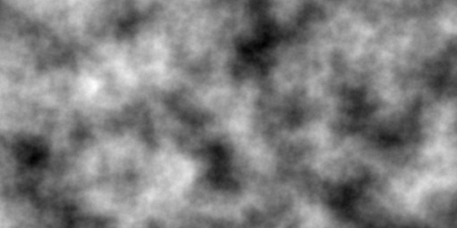
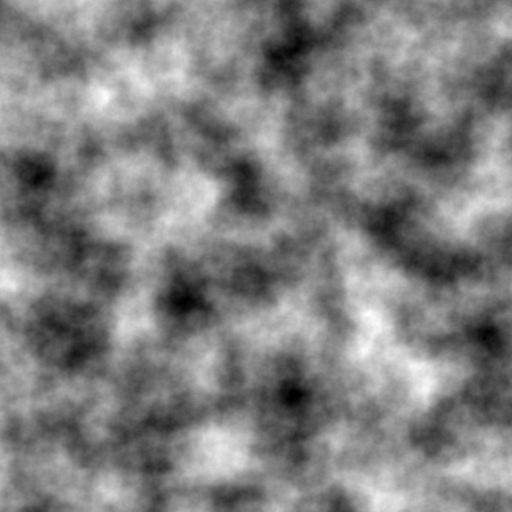
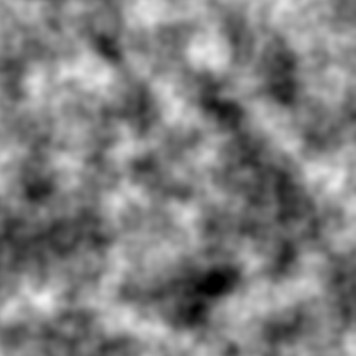

# siv::PerlinNoise


**siv::PerlinNoise** is a header-only Perlin noise library for modern C++ (C++17/20).  
The implementation is based on Ken Perlin's [Improved Noise](https://cs.nyu.edu/~perlin/noise/).

## Features
* 1D / 2D / 3D noise
* octave noise
* initial seed
* *(✨ new in v3.0)* produce the same output on any platform (except for floating point errors)

## License
siv::PerlinNoise is distributed under the **MIT license**.

## Usage

```cpp
# include <iostream>
# include "PerlinNoise.hpp"

int main()
{
	const siv::PerlinNoise::seed_type seed = 123456u;

	const siv::PerlinNoise perlin{ seed };
	
	for (int y = 0; y < 5; ++y)
	{
		for (int x = 0; x < 5; ++x)
		{
			const double noise = perlin.octave2D_01((x * 0.01), (y * 0.01), 4);
			
			std::cout << noise << '\t';
		}

		std::cout << '\n';
	}
}
```

## API

### `template <class Float> class BasicPerlinNoise`

- Typedefs
  - `using PerlinNoise = BasicPerlinNoise<double>;`
  - `using state_type = std::array<std::uint8_t, 256>;`
  - `using value_type = Float;`
  - `using default_random_engine = std::mt19937;`
  - `using seed_type = typename default_random_engine::result_type;`
- Constructors
  - `constexpr BasicPerlinNoise();`
  - `BasicPerlinNoise(seed_type seed);`
  - `BasicPerlinNoise(URBG&& urbg);`
- Reseed
  - `void reseed(seed_type seed);`
  - `void reseed(URBG&& urbg);`
- Serialization
  - `constexpr const state_type& serialize() const noexcept;`
  - `constexpr void deserialize(const state_type& state) noexcept;`
- Noise (The result is **in the range [-1, 1]**)
  - `value_type noise1D(value_type x) const noexcept;`
  - `value_type noise2D(value_type x, value_type y) const noexcept;`
  - `value_type noise3D(value_type x, value_type y, value_type z) const noexcept;`
- Noise (The result is **remapped to the range [0, 1]**)
  - `value_type noise1D_01(value_type x) const noexcept;`
  - `value_type noise2D_01(value_type x, value_type y) const noexcept;`
  - `value_type noise3D_01(value_type x, value_type y, value_type z) const noexcept;`
- Octave noise (The result **can be out of the range [-1, 1]**)
  - `value_type octave1D(value_type x, std::int32_t octaves, value_type persistence = value_type(0.5)) const noexcept;`
  - `value_type octave2D(value_type x, value_type y, std::int32_t octaves, value_type persistence = value_type(0.5)) const noexcept;`
  - `value_type octave3D(value_type x, value_type y, value_type z, std::int32_t octaves, value_type persistence = value_type(0.5)) const noexcept;`
- Octave noise (The result is **clamped to the range [-1, 1]**)
  - `value_type octave1D_11(value_type x, std::int32_t octaves, value_type persistence = value_type(0.5)) const noexcept;`
  - `value_type octave2D_11(value_type x, value_type y, std::int32_t octaves, value_type persistence = value_type(0.5)) const noexcept;`
  - `value_type octave3D_11(value_type x, value_type y, value_type z, std::int32_t octaves, value_type persistence = value_type(0.5)) const noexcept;`
- Octave noise (The result is **clamped and remapped to the range [0, 1]**)
  - `value_type octave1D_01(value_type x, std::int32_t octaves, value_type persistence = value_type(0.5)) const noexcept;`
  - `value_type octave2D_01(value_type x, value_type y, std::int32_t octaves, value_type persistence = value_type(0.5)) const noexcept;`
  - `value_type octave3D_01(value_type x, value_type y, value_type z, std::int32_t octaves, value_type persistence = value_type(0.5)) const noexcept;`
- Octave noise (The result is **normalized to the range [-1, 1]**)
  - `value_type normalizedOctave1D(value_type x, std::int32_t octaves, value_type persistence = value_type(0.5)) const noexcept;`
  - `value_type normalizedOctave2D(value_type x, value_type y, std::int32_t octaves, value_type persistence = value_type(0.5)) const noexcept;`
  - `value_type normalizedOctave3D(value_type x, value_type y, value_type z, std::int32_t octaves, value_type persistence = value_type(0.5)) const noexcept;`
- Octave noise (The result is **normalized and remapped to the range [0, 1]**)
  - `value_type normalizedOctave1D_01(value_type x, std::int32_t octaves, value_type persistence = value_type(0.5)) const noexcept;`
  - `value_type normalizedOctave2D_01(value_type x, value_type y, std::int32_t octaves, value_type persistence = value_type(0.5)) const noexcept;`
  - `value_type normalizedOctave3D_01(value_type x, value_type y, value_type z, std::int32_t octaves, value_type persistence = value_type(0.5)) const noexcept;`

## Direct ray tracing of the `noise2D` height field

`BasicPerlinNoise<double>` can intersect a ray with the height field
`y = noise2D(x, z)` directly, without baking a high-resolution mesh:

```cpp
siv::RayHit2D hit = perlin.intersectHeight(
    ox, oy, oz, dx, dy, dz, // ray P(t) = O + t D
    t0, t1,                 // search the closed interval [t0, t1]
    tolerance, max_nodes);
```

### The continuous function being solved

`noise2D(x, z)` is `noise3D(x, z, SIVPERLIN_DEFAULT_Z)`. Inside every integer
`(x, z)` cell it is one fixed **piecewise polynomial**: the permutation-table
gradients are affine, `Fade` is the quintic `6t^5 - 15t^4 + 10t^3`, and `Lerp`
is linear. The fixed `z` slice turns every `z`-gradient term and `Fade(fz)`
into a cell constant, so each cell is a bivariate polynomial of degree at most
6 on each axis. Along a ray the two local coordinates are linear in `t`, which
gives a univariate polynomial of degree at most 11.

The solver promotes all of this to `double` real arithmetic and shares the
instance permutation/gradient rules with `noise2D`; it does **not** replay the
per-operation float rounding of the scalar path, fit a discrete approximation,
march a fixed step, or read only segment endpoint signs.

### First-root isolation

1. The ray is split at every integer `x`/`z` grid line it crosses; the same
   `(k - o) / d` formula handles negative directions and rays that start on a
   grid line, and cells are visited near to far.
2. In each cell the degree-≤11 polynomial `f(t) = y(t) - noise2D(x(t), z(t))`
   is built and recursively bisected. Root-free intervals are discarded using
   a conservative Bernstein-coefficient range (the convex-hull property) with
   an explicit rounding margin, so a bound that merely touches zero never
   excludes an interval.
3. The first interval that contains an isolated root and is no wider than
   `tolerance` is returned as a `Hit` containing the earliest root. A point
   exactly on the surface may come back as a zero-width `Hit`
   (`t_lo == t_hi`). If every cell is proven root-free the result is `Miss`.

### Result and budget

`RayHit2D` holds `Status status` (`Hit`, `Miss`, `Uncertain`, `Invalid`) and
`double t_lo, t_hi` on the **original** `t` scale (the direction is never
normalized). Preconditions: all inputs finite, `t0 <= t1`,
`1e-10 <= tolerance <= 1e-3`, `1 <= max_nodes <= 1000000`, a non-zero
direction, endpoint `|x|, |z| <= 10000`, and at most 512 crossed integer grid
lines in total; otherwise the result is `Invalid`. Every polynomial interval
check counts against `max_nodes`.

- `Hit` — `[t_lo, t_hi]` is at most `tolerance` wide and contains the earliest
  root in `[t0, t1]`.
- `Miss` — the whole interval is *proven* to contain no root.
- `Uncertain` — the node budget was exhausted, or a tangential / near-multiple
  root cannot be isolated reliably. `[t_lo, t_hi]` is the earliest interval
  that still contains a possible root; an unresolved earlier candidate always
  shadows later, definite roots and is never reported as a `Miss`.

**Tangency limitation.** Even-multiplicity (grazing) roots do not change sign,
so a tight interval whose endpoints keep the same sign cannot be certified as a
root without more structure than a conservative polynomial bound provides.
Such intervals, and any interval left when the budget runs out, are returned as
`Uncertain` rather than guessed. Ordinary transverse crossings return `Hit`
within budget, and intervals far from the surface return `Miss`.

The query is `const` and does not modify the permutation state; repeated calls,
and calls after `reseed` / `deserialize`, always use the live table.

### Example

`examples/raytrace.cpp <output-dir>` ray-traces a 64×64 patch and writes
`depth.pgm` (Hit depth; Miss and Uncertain use reserved, distinct gray values)
and `status.pgm` (one gray per status), then prints the count of each status.

## Example
Run example.cpp with the following parameters.

```
frequency = 8.0
octaves = 8
seed = 12345
```



---

```
frequency = 8.0
octaves = 8
seed = 23456
```


---

```
frequency = 8.0
octaves = 3
seed = 23456
```


