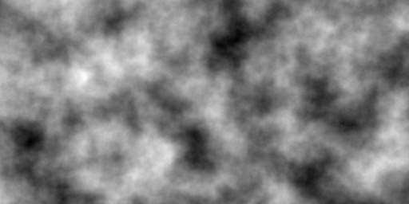
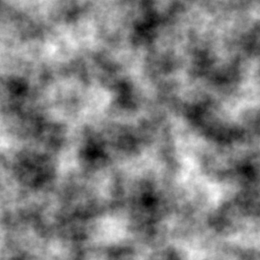
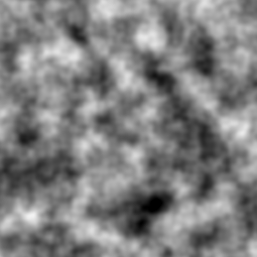

# siv::PerlinNoise


**siv::PerlinNoise** is a header-only Perlin noise library for modern C++ (C++17/20).  
The implementation is based on Ken Perlin's [Improved Noise](https://cs.nyu.edu/~perlin/noise/).

## Features
* 1D / 2D / 3D noise
* octave noise
* initial seed
* *(✨ new in v3.0)* produce the same output on any platform (except for floating point errors)

## License
siv::PerlinNoise is distributed under the **MIT license**.

## Usage

```cpp
# include <iostream>
# include "PerlinNoise.hpp"

int main()
{
	const siv::PerlinNoise::seed_type seed = 123456u;

	const siv::PerlinNoise perlin{ seed };
	
	for (int y = 0; y < 5; ++y)
	{
		for (int x = 0; x < 5; ++x)
		{
			const double noise = perlin.octave2D_01((x * 0.01), (y * 0.01), 4);
			
			std::cout << noise << '\t';
		}

		std::cout << '\n';
	}
}
```

## API

### `template <class Float> class BasicPerlinNoise`

- Typedefs
  - `using PerlinNoise = BasicPerlinNoise<double>;`
  - `using state_type = std::array<std::uint8_t, 256>;`
  - `using value_type = Float;`
  - `using default_random_engine = std::mt19937;`
  - `using seed_type = typename default_random_engine::result_type;`
- Constructors
  - `constexpr BasicPerlinNoise();`
  - `BasicPerlinNoise(seed_type seed);`
  - `BasicPerlinNoise(URBG&& urbg);`
- Reseed
  - `void reseed(seed_type seed);`
  - `void reseed(URBG&& urbg);`
- Serialization
  - `constexpr const state_type& serialize() const noexcept;`
  - `constexpr void deserialize(const state_type& state) noexcept;`
- Noise (The result is **in the range [-1, 1]**)
  - `value_type noise1D(value_type x) const noexcept;`
  - `value_type noise2D(value_type x, value_type y) const noexcept;`
  - `value_type noise3D(value_type x, value_type y, value_type z) const noexcept;`
- Noise (The result is **remapped to the range [0, 1]**)
  - `value_type noise1D_01(value_type x) const noexcept;`
  - `value_type noise2D_01(value_type x, value_type y) const noexcept;`
  - `value_type noise3D_01(value_type x, value_type y, value_type z) const noexcept;`
- Octave noise (The result **can be out of the range [-1, 1]**)
  - `value_type octave1D(value_type x, std::int32_t octaves, value_type persistence = value_type(0.5)) const noexcept;`
  - `value_type octave2D(value_type x, value_type y, std::int32_t octaves, value_type persistence = value_type(0.5)) const noexcept;`
  - `value_type octave3D(value_type x, value_type y, value_type z, std::int32_t octaves, value_type persistence = value_type(0.5)) const noexcept;`
- Octave noise (The result is **clamped to the range [-1, 1]**)
  - `value_type octave1D_11(value_type x, std::int32_t octaves, value_type persistence = value_type(0.5)) const noexcept;`
  - `value_type octave2D_11(value_type x, value_type y, std::int32_t octaves, value_type persistence = value_type(0.5)) const noexcept;`
  - `value_type octave3D_11(value_type x, value_type y, value_type z, std::int32_t octaves, value_type persistence = value_type(0.5)) const noexcept;`
- Octave noise (The result is **clamped and remapped to the range [0, 1]**)
  - `value_type octave1D_01(value_type x, std::int32_t octaves, value_type persistence = value_type(0.5)) const noexcept;`
  - `value_type octave2D_01(value_type x, value_type y, std::int32_t octaves, value_type persistence = value_type(0.5)) const noexcept;`
  - `value_type octave3D_01(value_type x, value_type y, value_type z, std::int32_t octaves, value_type persistence = value_type(0.5)) const noexcept;`
- Octave noise (The result is **normalized to the range [-1, 1]**)
  - `value_type normalizedOctave1D(value_type x, std::int32_t octaves, value_type persistence = value_type(0.5)) const noexcept;`
  - `value_type normalizedOctave2D(value_type x, value_type y, std::int32_t octaves, value_type persistence = value_type(0.5)) const noexcept;`
  - `value_type normalizedOctave3D(value_type x, value_type y, value_type z, std::int32_t octaves, value_type persistence = value_type(0.5)) const noexcept;`
- Octave noise (The result is **normalized and remapped to the range [0, 1]**)
  - `value_type normalizedOctave1D_01(value_type x, std::int32_t octaves, value_type persistence = value_type(0.5)) const noexcept;`
  - `value_type normalizedOctave2D_01(value_type x, value_type y, std::int32_t octaves, value_type persistence = value_type(0.5)) const noexcept;`
  - `value_type normalizedOctave3D_01(value_type x, value_type y, value_type z, std::int32_t octaves, value_type persistence = value_type(0.5)) const noexcept;`

## Direct ray tracing of the heightfield (`intersectHeight`)

`BasicPerlinNoise<double>` can intersect a ray directly with the implicit
heightfield **y = noise2D(x, z)** — no high-resolution mesh has to be baked
first.

```cpp
struct RayHit2D
{
    enum Status { Hit, Miss, Uncertain, Invalid };
    Status status;
    double t_lo, t_hi;
};

RayHit2D intersectHeight(double ox, double oy, double oz,
                         double dx, double dy, double dz,
                         double t0, double t1,
                         double tolerance, unsigned max_nodes) const;
```

The ray is `P(t) = O + t D` and the method returns the **smallest**
intersection parameter inside the closed interval `[t0, t1]`.

### The function that is actually solved

`noise2D(x, z)` is treated as the *continuous* function obtained by carrying
out the permutation lookup, gradient dot products, quintic `Fade` and every
`Lerp` in real `double` arithmetic — not as a staircase of separately rounded
point samples. Inside each integer lattice cell that function is a single
bivariate polynomial. Because the fixed slice `SIVPERLIN_DEFAULT_Z` (the same
one `noise2D` passes to `noise3D`) makes the third fade coordinate constant,
restricting the cell polynomial to a ray gives a **univariate polynomial of
degree at most 11**. The hash chain and the 12-gradient rule are exactly the
ones used by `noise3D`, so this is the same random field, never a re-fitted or
independent one.

### First-root isolation

1. The ray is cut at every integer `x` / `z` lattice boundary it crosses
   inside `[t0, t1]` (negative directions and rays lying exactly on a grid
   line are handled). Each resulting segment stays inside one cell.
2. The degree-11 polynomial of that segment is converted to **Bernstein form**,
   whose coefficient range is a conservative bound on the polynomial's range.
3. A segment whose coefficients are strictly on one side of zero is *proven*
   root-free and discarded. Otherwise it is subdivided (de Casteljau), working
   from near to far, until a sign-straddling interval no wider than `tolerance`
   proves the earliest root by the intermediate value theorem.
4. A conservative rounding envelope is added to every bound. Coefficients that
   merely hug zero are never excluded and never declared to straddle, so a root
   cannot be silently missed.

There is no fixed-step marching, no endpoint-sign-only test, and no discrete
fitting of `noise2D`. Two crossings inside the same cell are handled, and the
earlier one is returned.

### Results and the tangency limitation

- **Hit** — an interval of width `<= tolerance` (a zero-width interval is
  allowed when a point lies exactly on the surface) that contains the earliest
  root. Results are returned in the input `t` scale; passing a differently
  scaled direction only rescales `t`.
- **Miss** — the whole interval was proven root-free.
- **Uncertain** — the node budget (`max_nodes`, which counts every polynomial
  interval check performed) was exhausted, or the earliest candidate is a
  near-tangent / near-multiple root that cannot be isolated reliably. `t_lo` /
  `t_hi` then bracket the earliest candidate that has not been ruled out; it is
  never reported as a Miss.
- **Invalid** — an argument fails the documented preconditions (non-finite
  inputs, `t0 > t1`, `tolerance` outside `[1e-10, 1e-3]`, `max_nodes` outside
  `[1, 1000000]`, a zero direction, endpoint `|x|/|z| > 10000`, or more than
  512 lattice-line crossings).

Ordinary transverse crossings resolve to a `Hit` while the budget holds, and
rays that stay clearly away from the surface return `Miss`; the solver does not
answer `Uncertain` to every request. The query is `const` and never changes the
permutation table, so repeated calls and calls after `reseed` / `deserialize`
always observe the real stored state. The legacy `noise*` and serialization
interfaces are unchanged.

### Example

`examples/raytrace.cpp <output-directory>` casts one ray per pixel of a 64×64
image and writes:

- `depth.pgm` — hit depth, with `0` reserved for a proven Miss and `255` for
  Uncertain;
- `status.pgm` — an explicit per-pixel status map (Uncertain is rendered as its
  own value, never merged into the background).

It also prints the number of pixels in each status.

## Example
Run example.cpp with the following parameters.

```
frequency = 8.0
octaves = 8
seed = 12345
```



---

```
frequency = 8.0
octaves = 8
seed = 23456
```


---

```
frequency = 8.0
octaves = 3
seed = 23456
```


